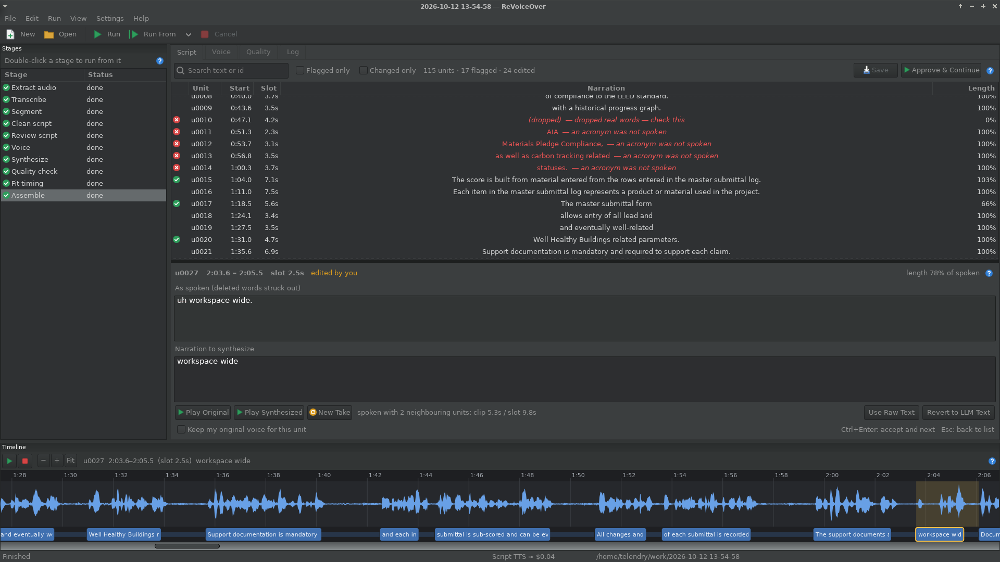

# ReVoiceOver

Re-narrate a screen recording in your own voice, without the ums.

ReVoiceOver transcribes a video's narration, cleans the script with a language
model (fillers, stutters, false starts, repeats), lets you review and edit it,
then re-speaks it in a clone of your voice, timed to the original video. The
result is a new video with clean narration and matching subtitles.

All model inference runs on [DeepInfra](https://deepinfra.com) using open
models. Media work runs locally with ffmpeg. A 10-minute recording costs well
under a dollar.

It comes as a wxPython desktop app (`narr-gui`) and a command-line tool (`narr`).
Both share the same pipeline and the same project folders.



## How it works

```
video ─► extract ─► transcribe ─► segment ─► clean ─► [ you review ] ─► voice ─► synth ─► qa ─► fit ─► assemble ─► clean.mp4 + clean.srt
```

| Stage | What it does |
|---|---|
| **extract** | Probes the video and extracts 16 kHz audio for recognition and 44.1 kHz audio for playback and voice reference. Long recordings are split at silences. |
| **transcribe** | Whisper (`whisper-timestamped-medium`) gives every word with its timing. A `glossary.txt` primes the spelling. |
| **segment** | Groups words into narration units that end at pauses or sentence ends. Each unit keeps its time slot in the video. |
| **clean** | An LLM (`Qwen3-235B-A22B-Instruct` by default) rewrites each unit, id for id, so text stays anchored to the video. Suspicious results are flagged. |
| **review** | The run pauses so you can read and edit the script. |
| **voice** | Picks a clean 8–15 s stretch of your speech, registers it once as a cloned voice, and remembers it. |
| **synth** | Speaks the script with Zonos in your cloned voice, in whole-sentence speech groups so intonation flows. |
| **qa** | Whisper listens to every clip and compares it with the script. Bad takes are retried; dropped words and acronyms are flagged; the voice's own noises between words are found for muting. |
| **fit** | Fits each clip into its slot: trims silence, speeds up slightly if needed, and slows the video only as a last resort. |
| **assemble** | Builds the narration track and muxes it onto the video. The video stream is copied when nothing was stretched. Writes subtitles. |

Every stage writes its results to the project's work folder. Runs can be
stopped and resumed, edits only redo what changed, and every API result is
cached so nothing is paid for twice.

## Requirements

- Linux (developed on Fedora 43), Python 3.11+
- **ffmpeg** and **ffprobe**. Fedora's `ffmpeg-free` works and includes
  `libopenh264` for the cases where video must be re-encoded.
- **wxPython 4.2** from your distribution, plus **PortAudio** for playback
- A **DeepInfra** API token

On Fedora:

```bash
sudo dnf install ffmpeg-free python3-wxpython4 python3-wxpython4-media portaudio
```

## Getting started

```bash
git clone git@github.com:Rational-Boxes/ReVoiceOver.git
cd ReVoiceOver
echo 'DEEPINFRA_TOKEN=your-token-here' > .env
./revoiceover.sh
```

On first run, `revoiceover.sh` creates a virtual environment in `.venv`
(with `--system-site-packages` so it sees the system wxPython) and installs
the app. After that it starts straight away. You can also pass a video or a
project folder:

```bash
./revoiceover.sh ~/Videos/demo.mp4
ln -s "$PWD/revoiceover.sh" ~/.local/bin/revoiceover   # start it from anywhere
```

In the app:

1. **File › New Project** (or drop a video onto the window).
2. **Run** (Ctrl+R). The run stops at **Review script**.
3. Review the **Script** tab. Tick *Flagged only* to see what needs attention,
   listen with Space, edit, and press Ctrl+Enter to move on.
4. **Approve & Continue** (Ctrl+Shift+R).
5. Check the **Quality** tab, fix or accept what is flagged, and find
   `clean.mp4` in the work folder (**File › Show Work Folder**).

Press **F1** at any time for help on the current tab. The built-in help covers
every panel and setting.

### The DeepInfra token

The token is looked up in this order:

1. the `DEEPINFRA_TOKEN` (or `DEEPINFRA_KEY`) environment variable;
2. a `.env` file in the current folder or one of its parents, then
   `~/.config/narr/.env`, or exactly the file given with `--env-file`;
3. the system keyring (**Settings › DeepInfra Token…** or `narr token set`).

`revoiceover.sh` points the app at the repository's `.env` when no token is set
in the environment. The token is never written to project files or logs.
`.env` is git-ignored.

## Command line

```bash
narr run VIDEO                  # run until the review checkpoint
narr run VIDEO --from voice     # continue after editing script.json
narr run VIDEO --to transcribe  # stop after a stage
narr run VIDEO --no-review      # straight through
narr status VIDEO               # status of every stage
narr gui [VIDEO]                # open the desktop app
narr token set|clear|status
narr --env-file PATH ...
```

The command-line work folder defaults to `./work/<video name>`
(`--work-dir` to change). Projects created on the command line open in the app
and the other way round.

## Project files

```
work/<video name>/
  project.json              which video this folder belongs to
  audio_16k.wav, audio_full.wav, probe.json
  words.json                transcript with word timings
  units.json                narration units
  script.json, script.md    cleaned script, and a readable raw-vs-clean diff
  voice.json, voice_ref.wav cloned voice and its reference clip
  tts/, synth.json          synthesized speech groups
  qa.json                   quality-check results
  fitted/, timeline.json    fitted clips and the output timeline
  narration.wav, clean.mp4, clean.srt
  cache/                    cached API results
  run.log
```

Optional files next to the video:

- **`glossary.txt`**: product names and acronyms, one per line. Improves
  transcription and tells the cleanup model to spell them exactly.
- **`pronunciations.toml`**: how to *say* terms the voice gets wrong. Used for
  speech only, so the script and subtitles keep the real text.

  ```toml
  "AIA"  = "A I A"
  "LEED" = "leed"
  ```
- **`narr.toml`**: settings for the videos in that folder.

## Configuration

Settings are TOML, layered from `~/.config/narr/config.toml`, then `narr.toml`
next to the video, then `narr.toml` in the work folder (per video). Some
useful keys:

```toml
[models]
llm = "Qwen/Qwen3-235B-A22B-Instruct-2507"
tts = "Zyphra/Zonos-v0.1-hybrid"

[segment]
pause_split_s = 0.6          # a pause this long ends a unit

[synth]
group_sentence_gap_s = 0.8   # join sentences across pauses up to this
group_fragment_gap_s = 3.0   # always finish a sentence across pauses up to this
group_max_s = 25

[fit]
max_atempo = 1.15            # most a clip is sped up before the video is slowed

[qa]
max_wer = 0.15
max_retries = 3

[network]
concurrency = 6
```

## Costs

Measured on a 9½-minute screen recording (about 1,000 words):

| Step | Cost |
|---|---|
| Transcribe (whisper-timestamped-medium, billed by runtime) | $0.43 |
| Clean script | $0.002 |
| Synthesize (Zonos, $7 / M characters) | $0.04 |
| Quality check, including retries | ~$0.17 |

Re-runs only pay for what changed.

## Status

Working end to end in anchor timing: you can produce a finished, re-narrated
video with subtitles from the app or the command line. Still to come (see
[`design_documents/`](design_documents)):

- *compact* timing that also removes dead air from the video
- patch mode (keep your original voice where it was already clean),
  room-tone bed and crossfades
- export dialog, in-app video preview and a settings dialog

## Development

```bash
.venv/bin/pip install -e '.[gui,dev]'   # or: uv pip install -e '.[gui,dev]'
.venv/bin/pytest                        # GUI tests skip without a display
xvfb-run -a .venv/bin/pytest            # everything, headless
NARR_LIVE=1 .venv/bin/pytest -m live    # one real DeepInfra call (~1¢)
.venv/bin/ruff check narration tests
.venv/bin/mypy narration
```

Layout:

```
narration/
  cli.py, config.py, context.py, credentials.py, artifacts.py, cache.py, pipeline.py
  clients/      deepinfra.py (the one HTTP client), asr.py, llm.py, tts.py
  media/        ffmpeg.py (the only place that shells out), audio.py
  stages/       one module per stage, each with run(ctx)
  prompts/      clean_system.md
  gui/          wxPython app: main_frame, panels/, dialogs/, models/ (wx-free), help/
tests/          unit, integration (real ffmpeg), GUI smoke tests; fixtures from synthetic audio
design_documents/
```

The design and its reasoning are in
[`design_documents/narration-pipeline-plan.md`](design_documents/narration-pipeline-plan.md)
and [`design_documents/gui-plan.md`](design_documents/gui-plan.md).

## License

ReVoiceOver is free software, licensed under the
[GNU General Public License v3.0 or later](LICENSE) (GPL-3.0-or-later).

```
Copyright (C) 2026 James Hickman

This program is free software: you can redistribute it and/or modify it under
the terms of the GNU General Public License as published by the Free Software
Foundation, either version 3 of the License, or (at your option) any later
version.

This program is distributed in the hope that it will be useful, but WITHOUT ANY
WARRANTY; without even the implied warranty of MERCHANTABILITY or FITNESS FOR A
PARTICULAR PURPOSE. See the GNU General Public License for more details.

You should have received a copy of the GNU General Public License along with
this program. If not, see <https://www.gnu.org/licenses/>.
```
